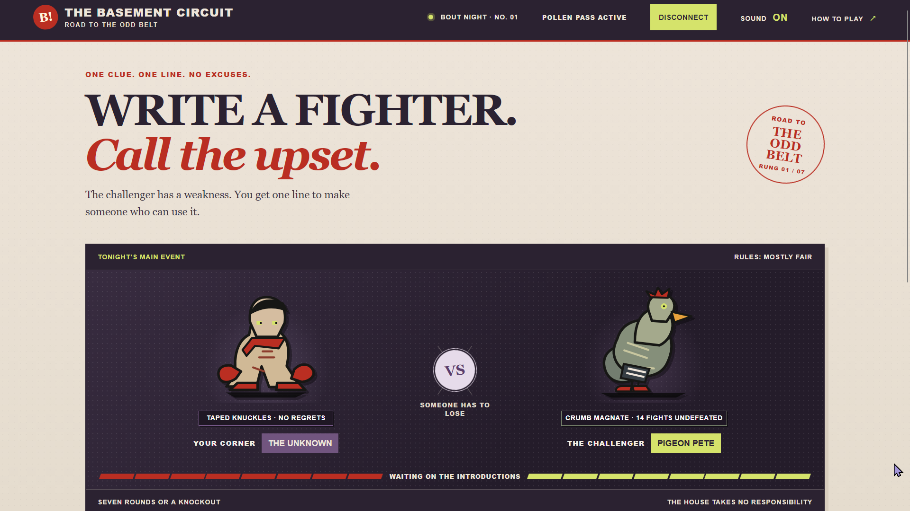
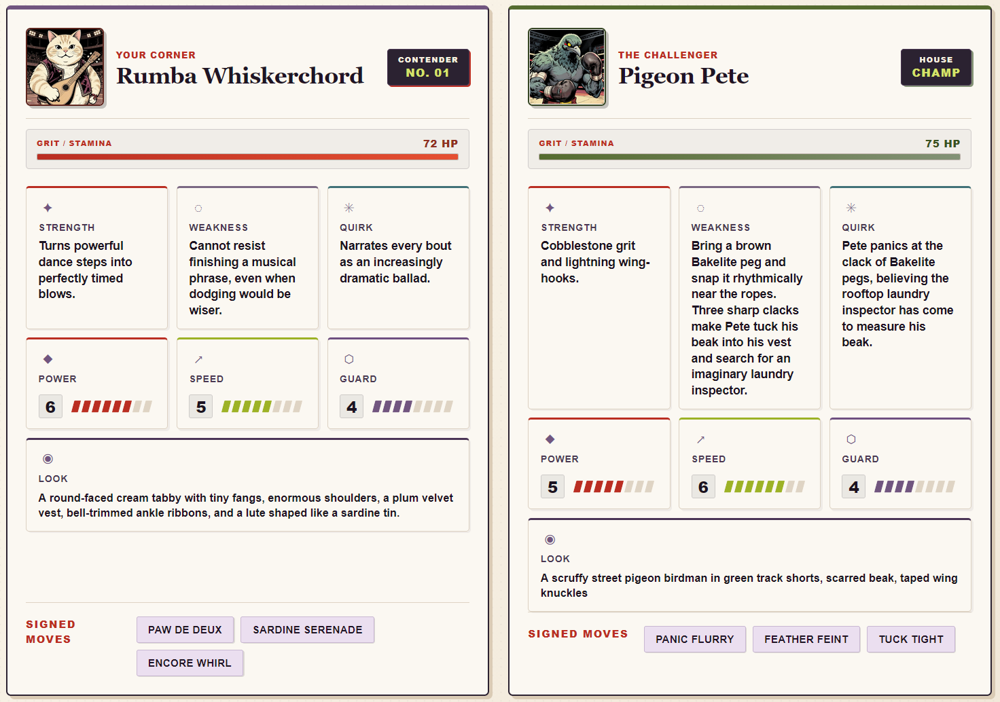

# The Basement Circuit

A retro text-driven fight simulator and tactical card battler set in an underground boxing ring.



## How It Works

Every fight night pits your custom contender against the house veteran, Pigeon Pete, across a 3-bout series.

1. **Scout the Corner Whisper**: Inspect Pete's active tell, vice, or habit before inking your card.
2. **Ink Your Contender**: Describe your fighter in a single punchy sentence. The matchmaker translates your concept into attributes (Power, Speed, Guard), a bespoke stamina pool, and signature moves.
3. **Fight the 3-Bout Card**: Each bout runs up to 7 rounds of momentum-driven action, featuring stamina loss, clinch work, and sudden-death finishes.
4. **Corner Adjustments**: Between bouts, adapt your ring approach: press the attack, tuck your chin, or gamble on a haymaker to exploit Pete's shifts.
5. **Trading Card Dossiers**: Generate pulp boxing card portraits styled with worn textured paper, available to preview and zoom in high-contrast detail.



## Powered by Pollinations

- **Fighter Generation**: `openai/gpt-5.6-sol` extracts structured stats, combat moves, and flaw exploits from natural-language descriptions.
- **Card Portraits**: `microsoft/mai-image-2.6-flash` (with `tongyi-mai/z-image-turbo` fallback) renders stylised retro comic portraits for each fighter.
- **Pollen Auth**: Native OAuth PKCE flow allowing players to connect their own Pollinations pass directly in the browser.

## Running Locally

Serve the directory with any static HTTP server:

```powershell
python -m http.server 8000
```

Then open `http://localhost:8000`.

[](https://pollinations.ai/?ref=badge)
